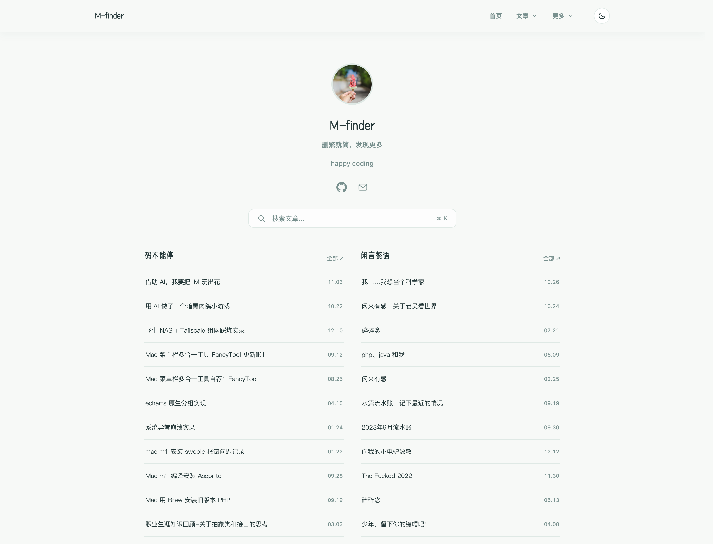
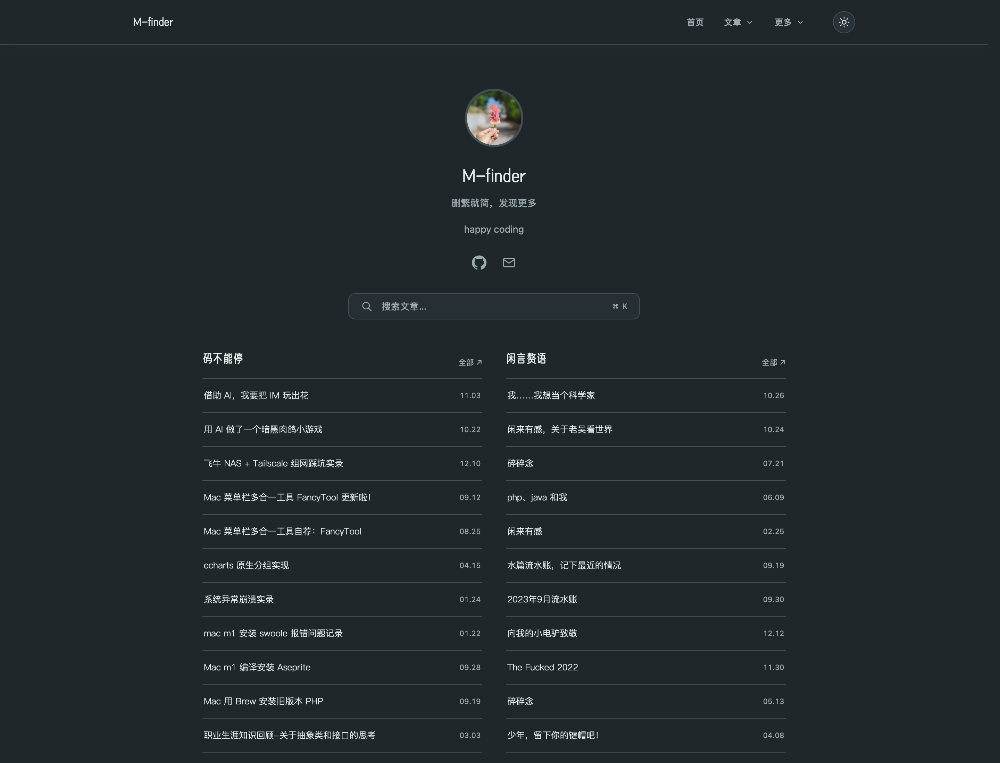

# Giorgio

简约的 Hexo 博客主题，支持浅色、深色和跟随系统三种外观。包含二级菜单、首页分类、站内搜索、相册、友链、说说、项目卡片、代码高亮、Giscus 评论和可选广告。

## 预览

| 浅色 | 深色 |
| --- | --- |
|  |  |

## 安装

在 Hexo 站点根目录运行：

```bash
git clone https://github.com/m-finder/hexo-theme-giorgio.git themes/giorgio
npm install hexo-renderer-ejs
```

在站点 `_config.yml` 中设置：

```yaml
theme: giorgio
```

运行 `npx hexo generate` 构建站点，或运行 `npx hexo server` 本地预览。主题配置位于 `themes/giorgio/_config.yml`；推荐在站点根目录建立 `_config.giorgio.yml` 覆盖个性化设置，这样更新主题时不会覆盖配置。

## 配置导航、头像与首页

主题 `_config.yml` 给出了所有选项的中文注释和可选值。一级菜单的值是链接；二级菜单使用嵌套映射：

```yaml
menu:
  首页: /
  发现:
    相册: /gallery/
    说说: /shuo/
```

`profile.avatar` 是首页头像路径，文件放在站点 `source` 目录下。`profile.align` 可设为 `left`、`center` 或 `right`，默认居中。导航栏默认只显示站点标题；设置 `logo.enable: true` 和 `logo.image` 后显示图片。

首页分类和每组条数可这样设置：

```yaml
home:
  limit: 12
  categories:
    - name: 技术
      limit: 8
    - name: 生活
      limit: 6
```

分类按名称或 slug 匹配，文章按发布时间倒序排列。`categories: []` 显示最近更新列表。`search.enable: true` 启用站内搜索，搜索索引由主题构建。`social` 可填写 GitHub、邮箱、RSS 或其他链接，例如：

```yaml
social:
  GitHub: https://github.com/your-name
  邮箱: mailto:you@example.com
```

## 外观与代码高亮

`appearance.mode` 可选 `auto`、`light`、`dark`，分别表示跟随系统、浅色、深色；页面右上角也可切换，浏览器会记住选择。`appearance.cursor_glow` 控制鼠标光斑。

代码高亮使用 Hexo 内置高亮。站点 `_config.yml` 保持：

```yaml
highlight:
  enable: true
  wrap: true
```

## 相册、友链与说说

相册入口优先读取站点 `source/_data/gallery.yml` 的 `albums`；没有时读取相册首页 front matter 中的 `albums` 或 `gallery.albums`。相册详情页可以使用普通 Markdown 图片列表，点击图片打开预览。

```yaml
# source/_data/gallery.yml
albums:
  - title: 花花世界
    cover: /gallery/world/cover.jpg
    path: /gallery/world/
    description: 日常照片
```

友情链接优先读取站点 `source/_data/link.yml` 中的分组 `link_list`，也支持页面 front matter 的 `links`。分组可使用 `class_desc`，单条友链的签名可使用 `descr`、`description` 或 `signature`。说说读取 `source/_data/shuoshuo.yml`。

## 评论与广告

评论默认关闭。启用 [Giscus](https://giscus.app/zh-CN) 时，把站点专属参数放在站点根目录的 `_config.giorgio.yml`：

```yaml
comments:
  enable: true
  repo: owner/repo
  repo_id: 仓库 ID
  category: Announcements
  category_id: 分类 ID
```

广告也默认关闭。Google AdSense 需要 `ads.google.enable`、`client` 和对应广告位 `slots.home`、`slots.post`、`slots.page`。原站广告脚本使用 `ads.original.enable`、`key`、`src`、`width`、`height`。将这些参数放在站点配置中，主题仓库不会包含个人广告标识。

## 页脚与豆瓣页面

`footer.since` 设置建站年份，`footer.privacy` 设置隐私政策路径。`footer.wormhole.position` 可选 `center` 或 `footer`；浅色主题显示 `image_light`，深色主题显示 `image_dark`。

读书、电影、游戏菜单对应 `/books/`、`/movies/`、`/games/`。如需这些页面，站点需安装并配置 `hexo-douban`，构建时由插件生成数据。

## 许可

主题代码采用 [MIT License](LICENSE)。本地使用的 `PingFang Regular.otf` 和 `YOUSHEhaoshenti-Regular.ttf` 未随仓库发布；如拥有字体使用授权，可自行放入 `themes/giorgio/source/css/`。未提供字体时，页面会使用系统字体回退。
